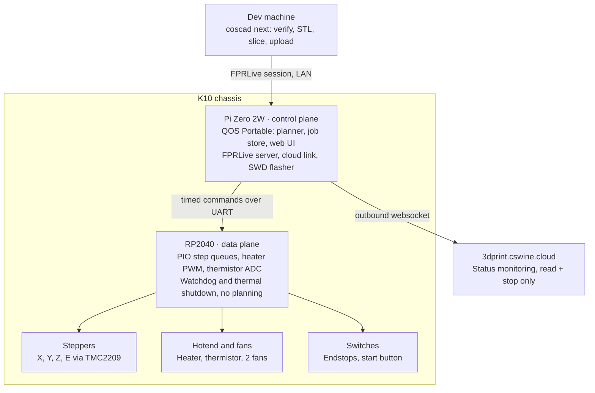

# K10 printer stack spec

Oct 23, 2026 · Jasen Qin

## Overview and goals

The K10 rig turns a cheap EasyThreed K10 into a self-contained printer on my own stack: an onboard Pi Zero 2W control plane and RP2040 data plane, discovered on the LAN, fed by `coscad next`, and visible on 3dprint.cswine.cloud.

Goals:

- Run the full CoScad → STL → slice → upload → queue → print pipeline end to end on hardware I fully control.
- Prove the control plane / data plane split before committing to a custom carrier PCB.
- Make the printer an always-on network appliance: status, job queue and logs served from inside the chassis.
- Keep every layer replaceable: Klipper first, my own G-code and firmware path later.

Non-goals:

- Production prints. The Bambu printers stay the parts printers, including ABS/ASA for this rig.
- Heated-bed materials or large parts. The K10 is 100 × 100 × 100 mm with no heated bed.
- Slicing on the printer by default. The Pi can run CoScad (Haskell, Linux aarch64), but slicing defaults to another machine.

## System architecture

The printer splits like Klipper does: the Pi plans and serves, the RP2040 executes timed commands and owns safety, and only the Pi touches the network.

The RP2040 talks only to the Pi and the hardware. If the Pi crashes or misbehaves, the data plane's watchdog shuts the heater down on its own.

## Hardware

The stock K10 board is replaced, not hacked: it has no host link and no endstops, and an off-the-shelf RP2040 board fixes both for about A$40.

**Stock K10, as reversed** ([source](https://palmarci.me/blog/2025-05-02-easythreed-k10-3d-printer-main-board-reversing/index.html))

| Part | Stock | Rig |
| --- | --- | --- |
| MCU | GD32F303, modified Marlin, SD-only | RP2040 (SKR Pico), then own carrier board |
| Stepper drivers | 4× HR4988 | 4× TMC2209, UART mode |
| Motors | X, Y, Z, E (small, non-NEMA 17) | Stock first; NEMA 17 upgrade later |
| Heater + thermistor | 1 hotend channel | Same, plus spare channel |
| Fans | 1 | 2 (hotend, part cooling) |
| Homing | Hard stops, no switches | Microswitches or TMC2209 sensorless |
| Host link | None (UART not routed) | UART to the onboard Pi |
| Power | 12 V barrel or USB-C PD | 12 V barrel |
| Buttons | 7 on the board underside | One physical start button, rewired |

**Mechanical upgrades** (printed in ASA on the Bambu printers)

1. Baseline prints on the stock machine first: calibration cube and ringing tower, kept for comparison.
2. Frame gussets and a brace on the cantilever arm. Measure arm flex before and after each part with a dial indicator.
3. Endstop switch mounts for X and Y.
4. Electronics enclosure in the base: SKR Pico, Pi Zero 2W, buck converter, start button. Kept low and away from the hotend.
5. NEMA 17 motor mounts, once the frame is stiff enough to use the torque.

**Carrier board (later phase)**

One PCB replacing the SKR Pico, laid out with my PCB generator once the protocol has settled:

- 12–24 V input; separate 5 V / 3 A buck for the Pi so motor current spikes cannot brown it out.
- 2×20 header for the Pi Zero 2W; UART (or SPI) plus SWD lines between the Pi and the RP2040.
- RP2040 with 4× TMC2209, a fused heater MOSFET, two fan MOSFETs, 2–3 thermistor inputs, several switch inputs.
- JST-XH connectors throughout.

## Onboard compute

The Pi Zero 2W runs a custom buildroot image with a read-only root, hosting QOS Portable as the printer's always-on control plane and web server.

**Image contents**

- QOS Portable and everything it needs, built from the minimal Linux appliance image.
- Klipper host (klippy) for phase 1, with `c_helper.so` prebuilt in the image. Klippy compiles it with gcc on first run if it is missing, so without prebuilding the image would need a compiler.
- mDNS / DNS-SD responder (avahi, or a native FP-RISC responder later).
- OpenOCD or an equivalent SWD flasher on Pi GPIO, so the Pi can reflash the RP2040.
- Optional: CoScad (Haskell, aarch64) for on-device slicing of small parts. Off by default.
- Not included: Moonraker and Mainsail. The UI is my own, served by QOS Portable, which keeps 512 MB of RAM comfortable.

**Filesystem layout**

| Partition | Mount | Mode | Holds |
| --- | --- | --- | --- |
| boot | /boot | read-only | Kernel, device tree, config |
| root | / | read-only | Buildroot userland, QOS Portable, klippy |
| data | /data | read-write | Job store, logs, printer config, credentials |

Read-only root is the default because an always-on box wears out SD cards through writes, not age. Updates replace the root image whole.

**Services**

| Service | Role |
| --- | --- |
| Printer control plane (FP-RISC actor) | Job queue, planning or klippy supervision, state machine |
| FPRLive server | LAN sessions from `coscad` and other clients |
| Cloud link | Outbound websocket to 3dprint.cswine.cloud |
| Web UI | Status, queue and logs at `http://k10.local` |
| Upload endpoint | Job uploads; optionally Moonraker-compatible so OrcaSlicer can send directly |
| Watchdog heartbeat | Periodic heartbeat to the data plane |

## Data plane

The RP2040 executes timed commands and enforces safety. It never plans motion, so its contract stays small enough to treat as the trusted core.

**Why an MCU rather than Pi GPIO**: Linux jitter is tens of microseconds even with PREEMPT_RT, the Pi has no ADC for thermistors, and heater safety must not depend on Linux staying up. RP2040 PIO generates step trains with cycle-exact timing.

**Firmware phases**

1. Stock Klipper MCU firmware for RP2040, driven by klippy on the Pi.
2. My own firmware implementing the same contract, driven by the FP-RISC control plane. Klipper's ideas are reused (clock sync, step compression, shutdown semantics); its code is not, which keeps my stack off GPL-3.

**Contract**

| Duty | Detail |
| --- | --- |
| Clock sync | Host maps its time to the MCU clock; every command is scheduled for a future MCU clock time |
| Step queues | Per axis, compressed segments of (interval, count, add); PIO emits the pulses |
| Driver config | TMC2209 currents and modes over UART; stall flags for sensorless homing |
| PWM | Heater and fans, with host-set targets |
| ADC | Thermistor sampling, reported to the host on a fixed period |
| Inputs | Endstops and the start button, timestamped |
| Shutdown | On any fault: heater off, steppers disabled, fault latched until the host clears it |

**Safety duties that live here, not on the Pi**

- Heartbeat watchdog: no host heartbeat within the timeout → shutdown.
- Thermal runaway: temperature outside the expected band for the commanded target → shutdown.
- Thermistor sanity: open or shorted reading → shutdown.
- Max-temperature ceiling compiled into the firmware, not settable from the host.

**Updates**: the Pi flashes the RP2040 over SWD. A data-plane image is a versioned module like any other, so the control plane can roll it forward or back.

## Discovery and connections

The printer has two independent links: a direct FPRLive session on the LAN, and an outbound websocket to the cloud app. Neither depends on the other.

**LAN discovery**

- The printer answers as `k10.local` and also advertises a DNS-SD service, e.g. `_fprlive._tcp`, with TXT records for printer model, firmware version and a public-key fingerprint.
- Clients browse for the service type rather than the hostname, so a second printer appears without config changes. `k10.local` stays as the human-friendly name.

**LAN session (`coscad` → printer)**

1. Browse `_fprlive._tcp`; pick the printer by name or prompt if several answer.
2. Connect and handshake: protocol version, printer identity (verified against the advertised fingerprint), client capability token.
3. Upgrade to a websocket FPRLive session carrying status, uploads and queue commands.
4. Session drops are harmless: queued jobs live on the printer, not in the session.

**Cloud link (printer → 3dprint.cswine.cloud)**

- The printer dials out and keeps one authenticated websocket open, so nothing on the home network accepts inbound connections.
- It pushes status (state, temperatures, job progress, faults) and accepts only the commands its cloud capability allows.
- Reconnect with backoff; on reconnect, send a full state snapshot before deltas.
- If the cloud is unreachable, the printer keeps printing and the LAN path is unaffected.

## coscad next

`coscad next <file>` takes a CoScad source to a queued job on the printer in one command, skipping any stage whose inputs are unchanged.

1. **Verify.** Run CoScad's checks on the source; stop on any error.
2. **Generate STL.** Evaluate the model and write the STL. Hash it.
3. **Slice.** Run OrcaSlicer's CLI headless with the K10 printer, filament and process profiles from the repo. Hash the G-code.
4. **Discover.** Find the printer over DNS-SD (or use `--printer <name>`).
5. **Upload.** Send the G-code plus its provenance record over the FPRLive session. The printer stores it by hash.
6. **Queue.** Append the job to the printer's queue. Starting is a separate, physical step (see the capability and safety model).

**Slicer profiles**

- The K10 has no stock Orca profile. Mine lives in the repo as versioned JSON: 100 × 100 × 100 mm volume, no bed heat, PLA defaults.
- Profiles are part of the provenance hash, so a profile change re-slices even when the STL is unchanged.
- The slicer is a swappable stage. CoScad's own dumb slicer can replace Orca later without changing stages 4–6.

**Flags (proposed)**

| Flag | Effect |
| --- | --- |
| `--printer <name>` | Target a specific printer instead of discovery |
| `--dry-run` | Run stages 1–3 only; print hashes |
| `--no-queue` | Upload without queuing |
| `--on-device` | Slice on the printer's Pi with CoScad instead of locally |

## Job store and provenance

Jobs are content-addressed in the printer's append-only store, so uploads are idempotent and every print traces back to the exact source and profiles that made it.

**Provenance record** (one per job, itself hashed)

| Field | Value |
| --- | --- |
| `source` | Hash of the CoScad file (and its imports) |
| `stl` | Hash of the generated STL |
| `slicer` | Slicer name and version |
| `profiles` | Hashes of the printer, filament and process profiles |
| `gcode` | Hash of the G-code; the job's identity |
| `created` | Timestamp and client identity |

**Rules**

- The job ID is the G-code hash. Uploading the same job twice is a no-op that returns the existing ID.
- The store is append-only. Queue state, print attempts and outcomes are events appended alongside, never edits to the job.
- Each print attempt records start, end, outcome (done, cancelled, faulted) and any fault code from the data plane.
- `coscad` keeps the same hash chain locally, so stages with unchanged inputs are skipped.
- Garbage collection of old G-code is explicit and logged; provenance records are kept.

## Capability and safety model

Anything can queue a job, but only a physical button press on the printer starts heating and motion. That closes the unattended-remote-start hole without any software policy.

**Capabilities**

| Capability | LAN client (`coscad`) | Cloud app | Physical button |
| --- | --- | --- | --- |
| Read status, logs, queue | Yes | Yes | — |
| Upload and queue job | Yes | No | — |
| Reorder or remove queued job | Yes | No | — |
| Start job (heat + motion) | No | No | Yes |
| Pause, cancel, emergency stop | Yes | Yes | Yes (long press) |
| Set temperatures manually | Yes | No | — |
| Flash data-plane firmware | Yes, with a separate admin token | No | — |

Cancel and stop are allowed from every path because making the printer safer should never need extra permission.

**How capabilities are granted**

- Each client holds a token naming its capabilities, issued from the printer's own UI or an admin `coscad` command.
- The printer's control plane is a `.qa` program whose manifest declares the device access it needs (serial to the RP2040, GPIO for SWD and the button, network). Nothing else on the Pi gets those.
- The cloud token is read-plus-stop only. Widening it is a deliberate local action, never a cloud setting.

**Safety layers**

1. Data plane: watchdog, thermal runaway, thermistor sanity, compiled-in max temperature (see Data plane).
2. Control plane: refuses to start without a button press; refuses jobs whose profile does not match the printer.
3. Physical: fused heater circuit; button for start and emergency stop.

## Build plan and open questions

Each phase ends in something that prints, so the rig is never broken for long.

1. **Stock baseline.** Buy the K10, print calibration parts from SD on stock firmware with my slicer output. Done when baseline prints are kept and arm flex is measured.
2. **Mechanics.** Print ASA gussets, arm brace, switch mounts, enclosure. Done when flex is measurably lower than baseline.
3. **Board swap + Klipper.** SKR Pico + Pi Zero 2W, stock Klipper on both, endstops fitted. Done when a print runs from klippy on the Pi.
4. **Appliance image.** Buildroot image with read-only root, QOS Portable, DNS-SD, web UI, job store. Done when `k10.local` serves status and queue.
5. **coscad next.** Pipeline stages 1–6, LAN FPRLive session, physical start button. Done when one command takes a CoScad file to a queued job.
6. **Cloud link.** Outbound websocket to 3dprint.cswine.cloud. Done when status shows there with the LAN path unaffected.
7. **Own data plane.** My RP2040 firmware implementing the contract; FP-RISC control plane replaces klippy. Done when the same print matches the Klipper baseline.
8. **Carrier board.** Custom PCB replacing the SKR Pico. Done when the rig runs with no off-the-shelf controller board.

**Open questions**

- [ ] Pi ↔ RP2040 link: UART at a fixed baud, or SPI for headroom?
- [ ] Sensorless homing on the K10's small steppers, or physical microswitches?
- [ ] Does the stock 12 V adapter have enough headroom for TMC2209 drivers plus the Pi?
- [ ] Expose a Moonraker-compatible upload endpoint, or keep uploads FPRLive-only?
- [ ] How is a capability token revoked if a client is lost?
- [ ] Does 3dprint.cswine.cloud show multiple printers from the start, or the K10 only?
